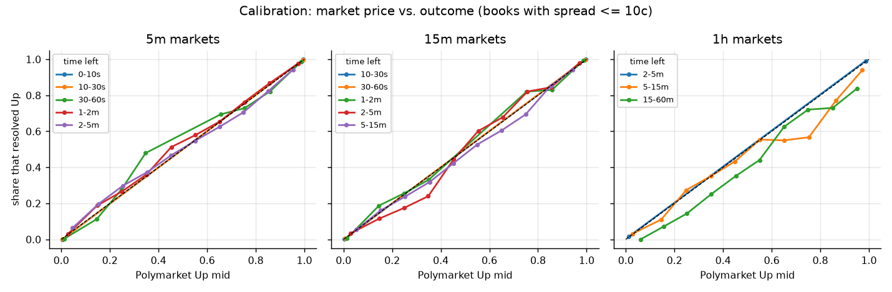
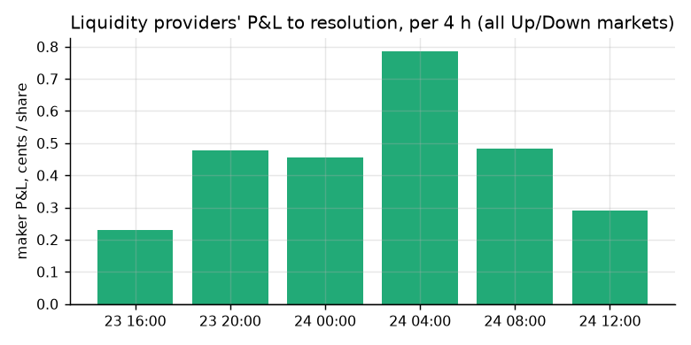
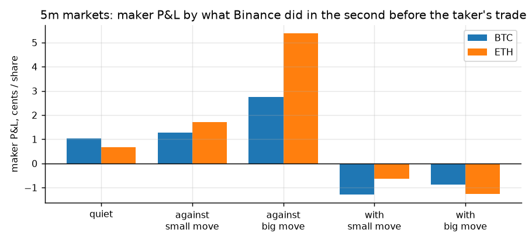
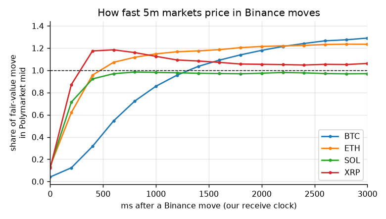
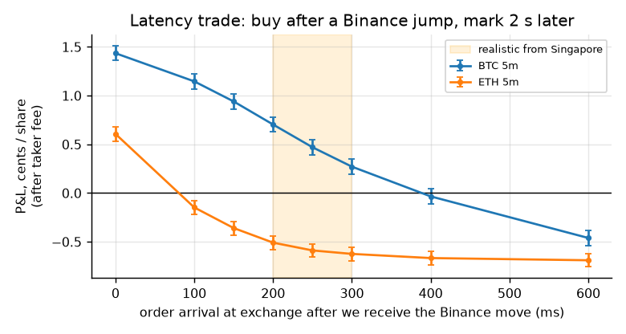

# Calibration & fair-value study: Up/Down markets

**Data:** 2026-11-23 18:50 – 2026-11-24 14:45 UTC (~20 h, after the development period). 2,673
resolved 5m/15m/1h markets on 8 coins, 323,760 point-in-time snapshots and 647,437 trades.
**Reproduce:** `cd analysis && uv run python -m polydata.research.study`. It regenerates every number
and chart here (`calibration-study/results.json`).

**Bottom line:**
- The prices are hard to beat from the taker side.
- **Providing liquidity is profitable on average.** Most of the makers' losses come from trades that
  follow Binance moves, so a market maker that reacts quickly to Binance is the strategy to build
  first.
- A pure speed trade on BTC 5m exists but is marginal and shrinking at the latency we have from
  Singapore.

## How the markets settle (verified)

- **Final price:** the average of Chainlink prices over the last 60 s of the window. Our
  reconstruction is within 0.13 bp median.
- **Outcome:** Up if the final price ≥ `priceToBeat`. This held for 100% of markets, and our own
  average gives the right outcome for 635/635 5m markets.
- **Chainlink lag:** Chainlink prices reach us ~1.5 s after their timestamp.
- **Binance basis:** Binance futures trade **6–15 bp away from Chainlink** (BNB ~15 bp). That's a
  stable basis, so Binance *moves* are usable to update the price but Binance *levels* are not.

## 1. Is the market price calibrated?

**Mostly yes.** We regressed the outcome on the market log-odds by time left. A slope of 1 means
perfectly calibrated; below 1 means overconfident; above 1 means underconfident. 95% intervals come
from a block bootstrap over 15-minute blocks.

| 5m markets, time left | 2–5 min | 1–2 min | 30–60 s | 10–30 s |
|---|---|---|---|---|
| slope | 0.86 [0.75, 0.98] | 0.98 [0.88, 1.12] | 1.11 [1.02, 1.23] | 1.28 [1.16, 1.62] |

- **Small biases:** prices are slightly too extreme early in a 5m window and slightly too timid in
  the last minute.
- **Not tradeable after costs:** buying favourites (asks 0.80–0.99) in the last 60 s of tight books
  made −2.2 to +1.6¢ per share, with every interval spanning 0, in both halves of the data.
- **1h markets look miscalibrated, but that's the trend:** only 124 markets, and the period trended
  down (37% resolved Up).
- **Trap:** in **wide books** (spread > 10¢, mostly ZEC, HYPE, BNB), the ask isn't a real price.
  Buying favourites there lost **10–23¢ per share**. Any strategy must ignore quotes from wide books.

## 2. Does a fair-value model beat the market?

**The model:** P(Up) from:
- the Chainlink price, updated with the Binance move since its last tick
- `priceToBeat` and the time left
- Binance realized volatility (15 min)
- the 60-second averaging at settlement

It was tuned on the first half (best: 15-min vol × 1.2, with the Binance update) and scored on the
second half.

| Held-out half (spread ≤ 10¢) | Log loss | Brier |
|---|---|---|
| Polymarket mid | **0.397** | **0.130** |
| Fair-value model | 0.408 | 0.134 |
| Market + model combined (weights fitted on the first half) | 0.399 | — |

**No.** At 5-second resolution, the market already contains everything the model knows. Trading the
model's disagreements as a taker made **−1.0 to +0.5¢ per share** with 300 ms latency, all intervals
spanning 0, and **−1.7¢** with 1 s latency.

## 3. Do liquidity providers make money?

Every recorded trade, marked to the market's outcome. Makers pay no fee.

| | Value |
|---|---|
| Trades / shares / notional | 647k / 17.8M / $8.7M |
| **Maker P&L** | **+0.47¢ per share** [0.14, 0.78], about **$84k**; positive in every 4-hour period and both halves |
| Taker fees paid | $106k (0.59¢ per share) |
| By fee rate | 0.43¢ (BTC 5m/15m, rate 0.05) · 0.73¢ (others, rate 0.01) |
| By coin | BTC 0.41 · ETH 0.85 · SOL 1.13 · XRP 0.40 · BNB 1.97 · DOGE 2.00 · HYPE 2.65¢ (small volumes outside BTC/ETH) |

**Where the makers lose** (5m; what Binance did in the second before the trade):

| BTC 5m | Share of volume | Maker ¢ per share |
|---|---|---|
| Binance quiet | 53% | **+1.04** |
| Taker against the move | 18% | +1.3 to +2.7 |
| Taker **with** the move | 29% | **−0.9 to −1.3** |

ETH shows the same pattern. Takers who trade in the direction Binance just moved are informed (fast
bots). Everyone else pays the makers. **A maker that steps back when Binance moves avoids most of
the losses.**

## 4. How fast does Polymarket price in Binance moves?

| Reflected in the Polymarket mid after | 200 ms | 400 ms | 1 s |
|---|---|---|---|
| BTC 5m | 12% | 32% | 86% |
| ETH 5m | 62% | 96% | — |
| SOL / XRP 5m | 71% / 87% | ~100% | — |

**BTC is slow**, probably because its 5× higher taker fee needs bigger moves before repricing is
worth it. Small positive responses *before* our Binance timestamp show some participants see Binance
faster than our Singapore server.

**Network delays we measured:**
- Polymarket data reaches us ~126 ms after the exchange timestamp (95th percentile 318 ms).
- Binance data reaches us in ~38 ms.
- The Polymarket servers are ~200 ms round-trip from Singapore.

## 5. The pure latency trade

Buy right after a Binance jump, filled against the exchange's book at the moment the order would
arrive (by Polymarket's exchange timestamps), then mark at the mid 2 s later. Fee charged on entry.

**BTC 5m:**
- +0.94¢ per share at 150 ms arrival, **+0.47¢ at 250 ms**, 0 at 400 ms.
- 14k signals in 20 h; median ask depth 121 shares (about $40).
- The 250 ms result fell from +0.9¢ to +0.1–0.3¢ over the period, which suggests faster competitors.

**ETH and the others:** negative at any realistic latency.

**Verdict:** not worth building from Singapore. It could become viable from a server near
Polymarket's matching engine (location to be determined).

## Caveats

- **About 20 hours, one market regime** (a down-trend). Outcomes of different coins in the same
  period are correlated, which is why all intervals use 15-minute block bootstraps. **Rerun at 7 and
  14 days before trusting any number.**
- **The maker P&L is the average over all makers, including the fastest and best-placed.** A
  newcomer at the back of the queue gets more toxic fills. Only the backtester, with a conservative
  fill model, can tell what *we* would earn.
- **Markouts are at the mid**, not at a price we could exit at. Holding to resolution has the same
  expected value but a lot of variance.

## What this means for what we build

1. **Backtester, built around market making first:**
   - Quote around the market mid or fair value, only in tight books.
   - Pull or reprice quotes within ~100–200 ms of a Binance move.
   - Inventory limits per market; hold to resolution or flatten.
   - Fills only when the market trades through our price.
   - Latency is a parameter: data delay 126 ms, order and cancel delay 130–250 ms.
2. **Find Polymarket's matching-engine location.** Being close to it would help both the maker's
   cancel speed and the latency trade.
3. **Rerun this study** (`python -m polydata.research.study`) at 7 and 14 days of data.
